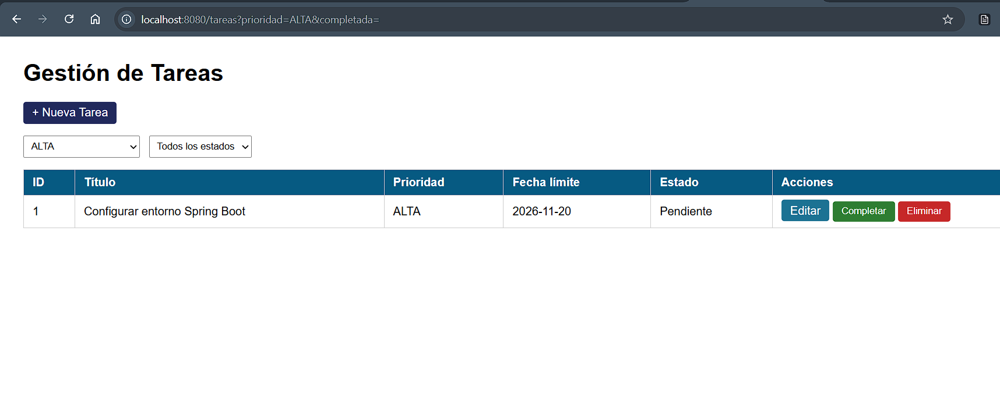
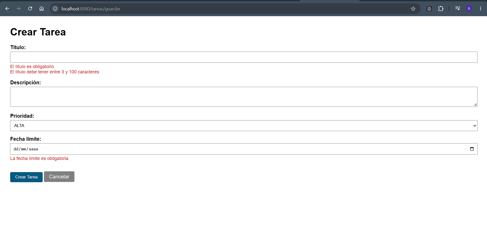
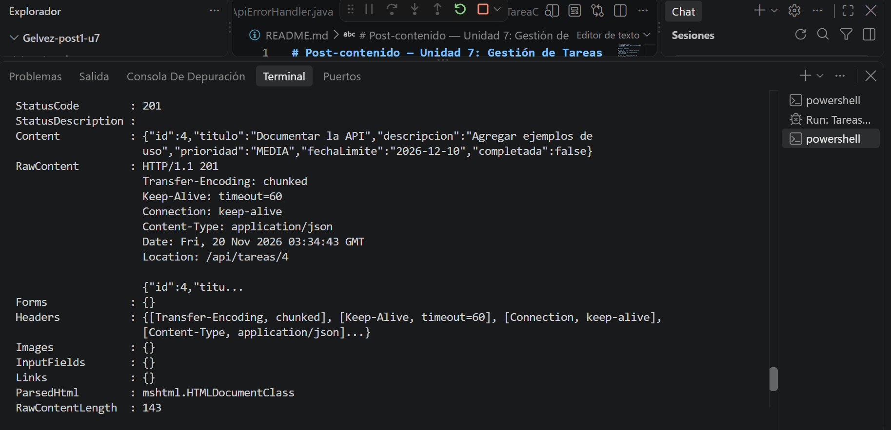
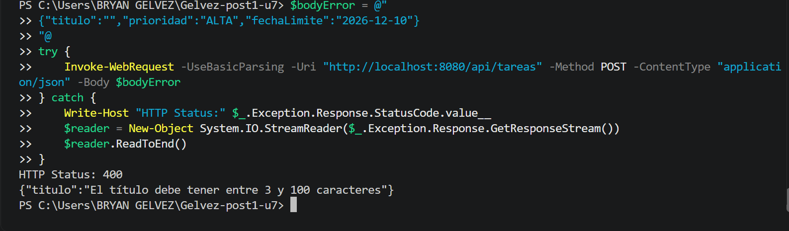

# Post-contenido — Unidad 7: Gestión de Tareas con Spring Boot

**Estudiante:** Bryan Sneider Gelvez Toloza  
**Carrera:** Ingeniería de Sistemas — 7° Semestre  
**Universidad:** Universidad Francisco de Paula Santander (UFPS)  
**Año:** 2026  

## Descripción
Repositorio del laboratorio de la Unidad 7 de Programación Web — Séptimo Semestre (`Gelvez-post1-u7`). Contiene un único proyecto Spring Boot (`gestion-tareas`) con dos capas compartiendo la misma instancia singleton de `TareaService`: una vista web con Thymeleaf (`@Controller`, Parte 1) y una API REST en formato JSON (`@RestController`, Parte 2).

## Prerrequisitos
- JDK 17 o superior instalado y configurado en el `PATH`.
- Apache Maven 3.8+ (o wrapper `mvnw`).
- IDE con soporte para Java y Spring Boot (VS Code o IntelliJ IDEA).
- Postman o `curl` para pruebas de la API REST.

## Parte 1 — Vista Thymeleaf con `@Controller`
`TareaController` expone `/tareas` con filtrado combinable mediante `@RequestParam` (`prioridad` y `completada`), formularios validados con `@Valid` + `BindingResult`, y las acciones de completar y eliminar implementadas como peticiones `POST` bajo el patrón Post/Redirect/Get (PRG).

## Parte 2 — API REST con `@RestController`
`TareaApiController` expone `/api/tareas` soportando los verbos HTTP `GET`, `POST`, `PUT`, `PATCH` y `DELETE`, inyectando por constructor la misma instancia de `TareaService` de la Parte 1. `ApiErrorHandler` (`@RestControllerAdvice`) captura `MethodArgumentNotValidException` y retorna los errores de validación como JSON estructurado (`400 Bad Request`).

## Endpoints de la API REST

| Método | URL | Código éxito | Código error | Descripción |
| :--- | :--- | :--- | :--- | :--- |
| `GET` | `/api/tareas` | `200 OK` | — | Lista de tareas en JSON, filtrable con `?prioridad=` y/o `?completada=`. |
| `GET` | `/api/tareas/{id}` | `200 OK` | `404 Not Found` | Retorna la tarea correspondiente al ID indicado. |
| `POST` | `/api/tareas` | `201 Created` | `400 Bad Request` | Crea una nueva tarea desde JSON; devuelve `400` si falla Bean Validation. |
| `PUT` | `/api/tareas/{id}` | `200 OK` | `404` / `400` | Reemplazo completo de una tarea existente. |
| `PATCH` | `/api/tareas/{id}/completar` | `200 OK` | `404 Not Found` | Actualización parcial: marca únicamente `completada = true`. |
| `DELETE` | `/api/tareas/{id}` | `204 No Content` | `404 Not Found` | Elimina la tarea con el ID indicado. |

## Decisiones de diseño
- **Inyección por constructor en ambos controladores:** Evita acoplar las clases al contenedor con `@Autowired` en campo, hace explícitas las dependencias y facilita las pruebas unitarias.
- **`@FutureOrPresent` en lugar de `@Future` para `fechaLimite`:** Permite registrar tareas cuyo vencimiento ocurre el mismo día de su creación.
- **`POST` (no `GET`) para completar y eliminar en `TareaController`:** Las peticiones `GET` deben ser seguras e idempotentes; las operaciones que alteran el estado del servidor deben ejecutarse mediante `POST`.
- **`PATCH` (no `PUT`) para `/api/tareas/{id}/completar`:** Representa semánticamente una actualización parcial de un único atributo sin obligar al cliente a reenviar todo el recurso.
- **Manejo de validación separado por capa:** `BindingResult` en `TareaController` para re-renderizar la vista HTML con errores por campo, y `@RestControllerAdvice` en la API para responder en formato JSON.
- **Persistencia en memoria (`Map` en `TareaService`):** Se utiliza almacenamiento en memoria administrado como bean singleton de Spring; la persistencia relacional con JPA/Hibernate se aborda en la Unidad 8.

## Cómo compilar y ejecutar
1. Clonar el repositorio: `git clone https://github.com/BryanGelvez23/Gelvez-post1-u7.git`
2. Abrir la carpeta `Gelvez-post1-u7` como proyecto Maven en el IDE.
3. Ejecutar `mvn spring-boot:run` desde la terminal o iniciar `TareasApplication.java`.
4. Acceder a:
   - **Vista web Thymeleaf:** `http://localhost:8080/tareas`
   - **API REST JSON:** `http://localhost:8080/api/tareas`

## Capturas de pantalla

### Vista web — Lista de tareas con filtros (`@RequestParam`)

### Vista web — Formulario con error de validación (`Bean Validation`)

### API REST — Creación exitosa (`POST 201 Created`)

### API REST — Validación fallida (`POST 400 Bad Request`)
